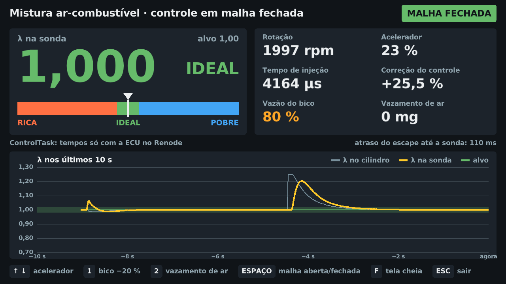

# Controle em malha fechada da mistura ar-combustível (STM32 + Renode)

Bancada simulada de uma ECU que controla a mistura ar-combustível a partir da sonda lambda.

- **ECU**: firmware C (HAL STM32F0 + FreeRTOS) para STM32F072, emulado no [Renode](https://renode.io).
- **Planta**: motor, escape e sonda simulados em Go, mestre do tempo da simulação.
- **Painel**: Go + raylib, uma tela, lendo o barramento CAN (`vcan0`).

Física e parâmetros: [`docs/equacoes.md`](docs/equacoes.md). Andamento: [`docs/PROGRESSO.md`](docs/PROGRESSO.md).



## Requisitos (Linux)

| | Arch | Fedora | Debian/Ubuntu |
|---|---|---|---|
| Toolchain ARM | `arm-none-eabi-gcc arm-none-eabi-newlib` | `arm-none-eabi-gcc-cs arm-none-eabi-newlib` | `gcc-arm-none-eabi libnewlib-arm-none-eabi` |
| Build | `base-devel cmake` | `gcc make cmake` | `build-essential cmake` |
| Go ≥ 1.24 ¹ | `go` | `golang` | `golang-go` |
| Painel (raylib) | `mesa libx11 libxrandr libxinerama libxcursor libxi wayland libxkbcommon` | `mesa-libGL-devel libX11-devel libXrandr-devel libXinerama-devel libXcursor-devel libXi-devel wayland-devel libxkbcommon-devel` | `libgl1-mesa-dev libx11-dev libxrandr-dev libxinerama-dev libxcursor-dev libxi-dev libwayland-dev libxkbcommon-dev` |
| Renode | Docker (`docker`; imagem fixada no `Makefile`) | `docker` ou `moby-engine` ² | `docker.io` |
| CAN | `can-utils` | `can-utils` | `can-utils` |

¹ Com uma versão de Go mais antiga, o próprio `go` baixa a 1.24 (`GOTOOLCHAIN=auto`, padrão).
² Seu usuário precisa rodar `docker` sem `sudo` (grupo `docker`).
O módulo `vcan` vem no kernel padrão; se o `modprobe vcan` falhar, instale `kernel-modules-extra`
(Fedora) ou `linux-modules-extra-$(uname -r)` (Ubuntu).

## Rodando a bancada

Teste rápido, sem toolchain ARM, Renode nem `vcan0`: `make painel-demo` roda o mesmo controle C
dentro do painel.

A bancada completa:

```sh
make firmware               # compila firmware/build/ecu.elf (precisa do arm-none-eabi-gcc)
./scripts/setup-vcan.sh     # cria vcan0 (pede sudo; refazer após reiniciar)
make run                    # terminal 1: ECU no Renode + planta (CSV em build/corrida.csv)
make painel                 # terminal 2: painel
candump vcan0               # opcional: os frames passando (can/lambda.dbc)
```

Sem o toolchain ARM instalado, `make firmware-docker` compila o mesmo `.elf` num container
(`docker/Dockerfile.toolchain`), e `make run`, `make test-integration`, `make test-e2e` e
`make renode` passam a usar esse caminho sozinhos.

Roteiro da apresentação: [`docs/roteiro-feira.md`](docs/roteiro-feira.md).

## Testes

```sh
make test-unit         # Unity (controle C) + go test (planta, SIL, CAN, painel)
make test-sil          # malha fechada C × planta Go, com as medições de acomodação
make test-integration  # SIL + testes Robot no Renode + cliente Go contra o Renode
make test-e2e          # ponta a ponta no vcan0 (ECU + planta + teste pelo CAN)
make grafico CSV=build/corrida.csv   # SVG de λ e do tempo de injeção de uma corrida
make renode            # Renode interativo com a ECU carregada (sem planta)
```

A CI (`.github/workflows/ci.yml`) roda tudo isso, inclusive o e2e com `vcan0`, e publica o CSV,
o gráfico e capturas do painel como artefatos.
